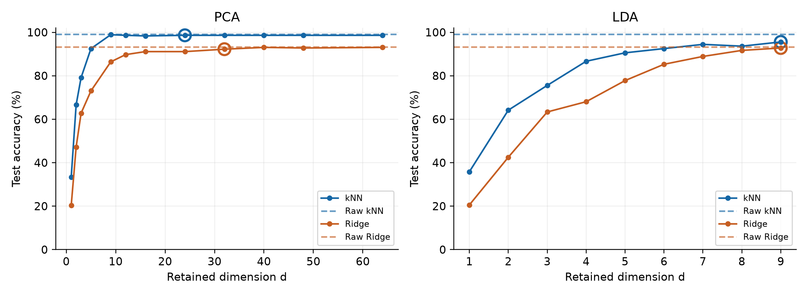
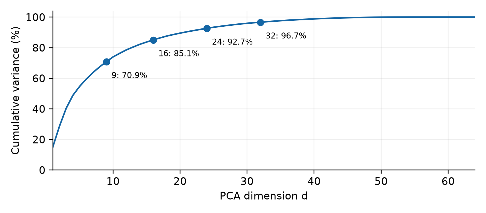

# Dimensionality Reduction for Handwritten Digit Classification / 手写数字分类中的降维

Assignment 1 | MENG XIANGYU | G2607496E
13 October 2026 / 2026 年 10 月 13 日

## Abstract / 摘要

**English (revised)**

The experiment examines the trade-off between classification accuracy and feature compression when principal component analysis (PCA) and linear discriminant analysis (LDA) are applied to 64-dimensional handwritten digits. It compares k-nearest-neighbour and ridge classifiers with raw-feature baselines on a stratified held-out test set. Dimensions and classifier settings are chosen within the non-test training pool. The raw 1-nearest-neighbour model reaches 99.17% test accuracy. The validation-selected 24-dimensional PCA model reaches 98.61%, while the 9-dimensional LDA model reaches 95.56%. Neither reduced representation beats its raw counterpart, but PCA removes 62.5% of the coordinates at the cost of only two additional test errors.

**中文翻译**

本实验考察将主成分分析（PCA）和线性判别分析（LDA）应用于 64 维手写数字时，分类准确率与特征压缩之间的权衡。实验在分层留出测试集上，将 k-近邻和岭分类器与原始特征基线进行比较。维度和分类器设置均在不包含测试集的训练数据池内选择。原始 1-近邻模型的测试准确率为 99.17%。验证集选出的 24 维 PCA 模型达到 98.61%，9 维 LDA 模型达到 95.56%。两种降维表示都没有超过各自的原始特征基线，但 PCA 只多产生两个测试错误，就减少了 62.5% 的坐标。

## 1. Research question and dataset / 研究问题与数据集

**English (revised)**

Two questions guide the experiment: how many coordinates are needed for accurate classification, and whether preserving overall variation or separating classes gives a more useful representation. Extra coordinates can increase storage and computation, while removing informative directions can increase error. The full input therefore serves as a baseline alongside a local nonlinear classifier and a linear classifier.

The public UCI Optical Recognition of Handwritten Digits dataset [1] provides block counts derived from normalized digit bitmaps. This experiment uses the 1,797-image subset distributed by scikit-learn's load_digits [2], rather than all 5,620 UCI samples. Each 8 x 8 image produces 64 integer features in the range 0-16 and a label from 0 to 9. Each class has approximately 180 examples, and there are no missing values. These 64 coordinates provide a manageable setting for studying dimensionality reduction; they are much smaller than modern high-resolution image representations.

**中文翻译**

本实验围绕两个问题展开：准确分类需要保留多少个坐标，以及保留总体变化还是分离类别能得到更有用的表示。额外坐标会增加存储和计算量，删除包含信息的方向则可能增加错误。因此，实验以完整输入作为基线，同时使用一个局部非线性分类器和一个线性分类器进行评估。

公开的 UCI 手写数字光学识别数据集 [1] 提供了由归一化数字位图得到的块计数。本实验使用 scikit-learn 的 load_digits 所分发的 1,797 张图像子集 [2]，而不是全部 5,620 个 UCI 样本。每张 8 x 8 图像产生 64 个取值范围为 0-16 的整数特征，以及一个取值为 0 至 9 的标签。每个类别约有 180 个样本，且没有缺失值。这 64 个坐标适合用于研究降维；与现代高分辨率图像表示相比，其规模要小得多。

## 2. Preprocessing and evaluation design / 预处理与评估设计

**English (revised)**

Each pixel is divided by the known maximum, 16, so that all values lie in [0,1]. This fixed conversion uses no statistic estimated from the test set. Pixelwise standardization, augmentation, and additional alignment are omitted because the source images are already normalized and all coordinates share the same physical unit. PCA centering and all LDA statistics are estimated only from the data used for fitting.

| Partition | Samples | Role |
| --- | --- | --- |
| Fit subset | 1,077 (~60%) | Fit candidate reductions and classifiers |
| Validation subset | 360 (~20%) | Choose dimensions and hyperparameters |
| Held-out test | 360 (~20%) | Final accuracy/error evaluation only |

A stratified split with seed 6222 reserves 20% of the data for testing. The remaining 1,437 samples form the training/development pool; a second stratified split with seed 6223 assigns 25% of that pool to validation. The test set contains 35-37 samples for each digit. After model selection, every final model is refitted on all 1,437 non-test samples. Test features are transformed only after fitting, and test labels are used only to score predictions [6]. The saved index arrays confirm that the partitions are disjoint.

**中文翻译**

每个像素都除以已知最大值 16，使所有取值落在 [0,1] 内。这一固定转换不使用从测试集估计的统计量。由于源图像已经规范化，且所有坐标具有相同的物理单位，实验不进行逐像素标准化、数据增强或额外对齐。PCA 的中心化和 LDA 的全部统计量只从拟合数据中估计。

| 数据划分 | 样本数 | 作用 |
| --- | --- | --- |
| 拟合子集 | 1,077（约 60%） | 拟合候选降维方法和分类器 |
| 验证子集 | 360（约 20%） | 选择维度和超参数 |
| 留出测试集 | 360（约 20%） | 仅用于最终准确率/错误率评估 |

第一次分层划分使用随机种子 6222，留出 20% 作为测试集。剩余的 1,437 个样本构成训练/开发数据池；使用随机种子 6223 进行第二次分层划分，将其中 25% 分配给验证集。测试集中每个数字有 35-37 个样本。完成模型选择后，每个最终模型都在全部 1,437 个非测试样本上重新拟合。测试特征只在拟合完成后进行变换，测试标签只用于为预测结果评分 [6]。保存的索引数组确认各数据划分彼此不重叠。

---

## 3. Dimensionality reduction and classifiers / 降维方法与分类器

**English (revised)**

**PCA.** For fitting observations x_{i}, let mu be their mean and S their sample covariance. PCA retains the d orthonormal eigenvectors with the largest eigenvalues, which can be obtained by singular value decomposition (SVD) [3].

S = sum_i (x_i-mu)(x_i-mu)^T / (n-1)

z = W_d^T (x-mu)

The implementation uses full SVD without whitening. At each training stage, it fits one maximum-size basis and retains its first d columns. The resulting representations are nested and keep the natural relative scale of the projected directions.

**LDA.** LDA uses labels to compare between-class scatter S_{B} with within-class scatter S_{W}. Given a class mean mu_{c} and class size n_{c}, the classical criterion favours projections with large between-class variation relative to within-class variation [4].

S_W = sum_c sum_(i in c) (x_i-mu_c)(x_i-mu_c)^T
S_B = sum_c n_c (mu_c-mu)(mu_c-mu)^T
S_B w = lambda S_W w

The SVD solver avoids directly inverting a potentially singular covariance matrix. Class proportions come from the fitting labels, the numerical rank tolerance is 10^{-4}, and no shrinkage is used. With ten classes, the discriminant subspace has at most nine directions. LDA is used only as a feature transformation; classification is then performed by the same two classifier families.

**Classifiers.** k-nearest neighbours (kNN) uses Euclidean distance and uniform voting, with brute-force neighbour search. The ridge classifier [5] learns ten linear scores, uses an unpenalized intercept, and predicts the class with the largest score. It minimizes squared loss with an L2 penalty on the coefficients; each one-versus-rest target column is encoded as +1 for the relevant class and -1 otherwise.

min_(B,b) ||Y - ZB - 1 b^T||_F^2 + alpha ||B||_F^2

| Setting | Predeclared candidates |
| --- | --- |
| Raw dimension | 64 |
| PCA dimensions | 1, 2, 3, 5, 9, 12, 16, 24, 32, 40, 48, 64 |
| LDA dimensions | 1, 2, 3, 4, 5, 6, 7, 8, 9 |
| kNN neighbours k | 1, 3, 5, 7, 9 |
| Ridge penalty alpha | 0.01, 0.1, 1, 10, 100 |

For each representation/classifier pair, the experiment selects the dimension and classifier parameter that give the highest validation accuracy. Ties favour the smaller dimension and then the earlier parameter in the listed grid, producing 220 validation configurations in total. The selected parameter is fixed for the pair's full test curve, while the validation-selected dimension is highlighted. Accuracy is the number of correct predictions divided by 360, expressed as a percentage; error rate is 100% minus accuracy.

**中文翻译**

**PCA。** 对拟合观测值 x_{i}，令 mu 为其均值，S 为其样本协方差。PCA 保留特征值最大的 d 个正交单位特征向量，这些向量可以通过奇异值分解（SVD）得到 [3]。

S = sum_i (x_i-mu)(x_i-mu)^T / (n-1)

z = W_d^T (x-mu)

实现使用完整 SVD，不进行白化。在每个训练阶段，先拟合一个最大规模的基，再保留其前 d 列。这样得到的表示彼此嵌套，并保留投影方向的自然相对尺度。

**LDA。** LDA 使用标签，将类间散度 S_{B} 与类内散度 S_{W} 进行比较。给定类别均值 mu_{c} 和类别大小 n_{c}，经典判据偏好类间变化相对于类内变化较大的投影 [4]。

S_W = sum_c sum_(i in c) (x_i-mu_c)(x_i-mu_c)^T
S_B = sum_c n_c (mu_c-mu)(mu_c-mu)^T
S_B w = lambda S_W w

SVD 求解器避免直接求逆可能奇异的协方差矩阵。类别比例由拟合标签得到，数值秩容差为 10^{-4}，不使用收缩。十个类别最多形成九个判别方向。LDA 仅作为特征变换使用，之后仍由同样的两类分类器完成分类。

**分类器。** k-近邻（kNN）使用欧氏距离和等权投票，并采用暴力搜索寻找邻居。岭分类器 [5] 学习十个线性得分，使用不受惩罚的截距，并预测得分最大的类别。它最小化带有系数 L2 惩罚的平方损失；每个一对其余目标列对相关类别编码为 +1，对其他类别编码为 -1。

min_(B,b) ||Y - ZB - 1 b^T||_F^2 + alpha ||B||_F^2

| 设置 | 预先声明的候选值 |
| --- | --- |
| 原始维度 | 64 |
| PCA 维度 | 1, 2, 3, 5, 9, 12, 16, 24, 32, 40, 48, 64 |
| LDA 维度 | 1, 2, 3, 4, 5, 6, 7, 8, 9 |
| kNN 邻居数 k | 1, 3, 5, 7, 9 |
| Ridge 惩罚 alpha | 0.01, 0.1, 1, 10, 100 |

对于每个表示/分类器组合，实验选择验证准确率最高的维度和分类器参数。出现平局时，优先选择较小的维度，再选择所列网格中较早的参数，共得到 220 个验证配置。所选参数固定用于该组合的整条测试曲线，验证集选出的维度会被突出显示。准确率是正确预测数量除以 360 后换算成百分比，错误率等于 100% 减去准确率。

---

## 4. Results: accuracy against retained dimension / 结果：准确率随保留维度的变化

**English (revised)**

Figure 1. Test accuracy on the held-out set. Hollow rings mark the dimensions selected on validation; dashed lines show independently tuned raw baselines. Each solid curve uses the parameter selected for its representation/classifier pair.

Table 1 lists the configurations selected before test evaluation. Validation accuracy comes from models fitted on 1,077 samples, whereas test accuracy comes from models refitted on 1,437 samples. All test comparisons use the same 360 held-out observations.

| Representation | Classifier | d | k / alpha | Val. % | Test % | Errors |
| --- | --- | --- | --- | --- | --- | --- |
| Raw | kNN | 64 | 1 | 98.89 | 99.17 | 3 |
| Raw | Ridge | 64 | 1 | 92.22 | 93.33 | 24 |
| PCA | kNN | 24 | 5 | 98.89 | 98.61 | 5 |
| PCA | Ridge | 32 | 10 | 92.50 | 92.22 | 28 |
| LDA | kNN | 9 | 1 | 97.50 | 95.56 | 16 |
| LDA | Ridge | 9 | 0.01 | 91.67 | 92.78 | 26 |

Table 1. Validation-selected configurations. k applies to kNN and alpha to Ridge.

**PCA trend.** With k=5, accuracy rises from 33.33% at d=1 to 79.17% at d=3 and 92.50% at d=5. The d=9 point reaches 98.89% on the test curve, followed by a plateau around 98-99%. Validation selects d=24, which gives 355 correct predictions and 98.61% accuracy. Selecting d=9 after viewing the test curve would use the test set for tuning. Ridge needs more coordinates: its accuracy rises from 20.28% at d=1 to 86.39% at d=9 and 92.22% at the selected d=32.

**LDA trend.** Accuracy generally increases as more discriminant directions are retained, although kNN dips slightly from d=7 to d=8. Both classifiers select d=9 on validation. At that dimension, kNN reaches 95.56% and Ridge reaches 92.78%. A label-informed reduction can still lose local distinctions because the LDA objective is global.

**Classifier dependence.** At the common d=9, PCA+kNN reaches 98.89%, compared with 95.56% for LDA+kNN. For Ridge, LDA reaches 92.78%, compared with 86.39% for PCA. These are independently tuned pipelines, so the pattern describes the interaction between representation and classifier rather than an isolated causal effect of the projection.

**中文翻译**

图 1. 留出测试集上的准确率。空心圆环标出验证集选出的维度；虚线表示独立调参得到的原始基线。每条实线曲线都使用其表示/分类器组合所选择的参数。

表 1 列出了测试评估前选择的配置。验证准确率来自使用 1,077 个样本拟合的模型，测试准确率来自使用 1,437 个样本重新拟合的模型。所有测试比较都使用相同的 360 个留出观测值。

| 表示 | 分类器 | d | k / alpha | 验证 % | 测试 % | 错误数 |
| --- | --- | --- | --- | --- | --- | --- |
| 原始 | kNN | 64 | 1 | 98.89 | 99.17 | 3 |
| 原始 | Ridge | 64 | 1 | 92.22 | 93.33 | 24 |
| PCA | kNN | 24 | 5 | 98.89 | 98.61 | 5 |
| PCA | Ridge | 32 | 10 | 92.50 | 92.22 | 28 |
| LDA | kNN | 9 | 1 | 97.50 | 95.56 | 16 |
| LDA | Ridge | 9 | 0.01 | 91.67 | 92.78 | 26 |

表 1. 通过验证集选择的配置。k 适用于 kNN，alpha 适用于 Ridge。

**PCA 趋势。** 在 k=5 时，准确率从 d=1 时的 33.33% 上升到 d=3 时的 79.17%，再到 d=5 时的 92.50%。d=9 在测试曲线上达到 98.89%，随后在约 98%-99% 附近进入平台。验证集选择了 d=24，该配置正确预测 355 个样本，准确率为 98.61%。在查看测试曲线后再选择 d=9，就会把测试集用于调参。Ridge 需要更多坐标：准确率从 d=1 时的 20.28% 上升到 d=9 时的 86.39%，并在选定的 d=32 时达到 92.22%。

**LDA 趋势。** 随着保留更多判别方向，准确率总体上升，但 kNN 在 d=7 到 d=8 之间略有下降。两种分类器都在验证集上选择 d=9。在该维度下，kNN 达到 95.56%，Ridge 达到 92.78%。即使利用标签，降维仍可能丢失局部差异，因为 LDA 优化的是全局判据。

**分类器依赖性。** 在共同的 d=9 下，PCA+kNN 达到 98.89%，LDA+kNN 为 95.56%。对于 Ridge，LDA 达到 92.78%，PCA 为 86.39%。这些是分别调参后的完整流程，因此这一模式反映的是表示与分类器之间的相互作用，而不是投影本身的单独因果效应。

---

## 5. Interpretation: compression, geometry and uncertainty / 解释：压缩、几何结构与不确定性

**English (revised)**

Figure 2. Cumulative PCA variance estimated from the 1,437-sample non-test training pool after final refitting. It is reported to interpret the results, not to choose d from the test curve.

**Variance versus discrimination.** The first 9 PCA directions preserve 70.85% of the fitting variance; 24 and 32 directions preserve 92.68% and 96.68%, respectively. The high kNN accuracy at d=9 shows that total variation and label discrimination are different objectives. The weak results at d=1-3 also show that aggressive reduction removes necessary digit structure. The later plateau only indicates that, for this pipeline and split, additional coordinates add little accuracy.

**Compression.** The selected PCA+kNN pipeline reduces 64 coordinates to 24, a 62.5% reduction. For 1,437 stored reference vectors, coordinate storage falls from 91,968 to 34,488 numbers. Because brute-force distance arithmetic scales approximately with n x d, the distance stage uses 37.5% of the original coordinate operations. This estimate excludes projection, basis storage, and other overheads; the experiment does not measure wall-clock speed. LDA reduces the coordinate count by 85.94%, but loses more kNN accuracy.

**Why supervised LDA is not automatically better.** LDA optimizes a global scatter criterion, whereas kNN relies on local distances. Rescaling the directions and limiting the projection to nine dimensions can change local neighbourhoods. PCA preserves orthogonal directions with large global variation. The observed ranking is consistent with this geometric difference, but it does not identify a single cause or establish a general advantage for either method.

**Implementation control.** With the same k=1, raw features and full 64-dimensional PCA produce identical predictions for all 360 test cases. Ridge gives the same result with alpha=1. Full, unwhitened PCA preserves Euclidean distances and the isotropic ridge penalty under an orthogonal coordinate change. The plotted PCA-64 values differ from the raw baselines because PCA independently selects k=5 and alpha=10.

**Sampling uncertainty.** Approximate marginal 95% Wilson intervals are 97.58-99.72% for raw kNN, 96.79-99.41% for selected PCA+kNN, and 92.90-97.25% for selected LDA+kNN. These intervals describe uncertainty conditional on the fitted model; they do not measure variation across data splits. In the paired PCA+kNN comparison, no test case is correct only after PCA, while two are correct only before PCA. The difference is two errors out of 360, so the experiment does not claim formal superiority or equivalence.

**中文翻译**

图 2. 最终重新拟合后，根据 1,437 个非测试训练样本估计的 PCA 累计方差。这里报告该统计量是为了帮助解释结果，而不是根据测试曲线选择 d。

**方差与判别。** 前 9 个 PCA 方向保留拟合方差的 70.85%；24 个和 32 个方向分别保留 92.68% 和 96.68%。d=9 时 kNN 仍有较高准确率，说明总体变化和标签判别是不同的目标。d=1-3 时的较弱结果也表明，过度降维会删除必要的数字结构。后续平台只说明，对于这条流程和这次划分，额外坐标带来的准确率增益很小。

**压缩。** 选择的 PCA+kNN 流程将 64 个坐标减少到 24 个，降幅为 62.5%。对于存储的 1,437 个参考向量，坐标存储量从 91,968 个数字降至 34,488 个数字。由于暴力距离计算的算术量大致与 n x d 成正比，距离计算阶段使用原始坐标运算量的 37.5%。这一估计不包括投影、基存储和其他开销；实验没有测量墙钟时间。LDA 将坐标数量减少了 85.94%，但 kNN 准确率下降更多。

**为什么有监督的 LDA 不会自动更好。** LDA 优化全局散度判据，而 kNN 依赖局部距离。方向的重新缩放以及九维投影限制可能改变局部邻域。PCA 保留总体变化较大的正交方向。观察到的排序与这种几何差异一致，但不能确定单一原因，也不能证明哪一种方法具有普遍优势。

**实现控制。** 在 k=1 相同的情况下，原始特征和完整 64 维 PCA 对全部 360 个测试样本产生完全相同的预测。alpha=1 时，Ridge 也得到相同结果。完整的非白化 PCA 在正交坐标变换下保持欧氏距离和各向同性岭惩罚不变。图中的 PCA-64 数值与原始基线不同，是因为 PCA 独立选择了 k=5 和 alpha=10。

**抽样不确定性。** 原始 kNN、选择的 PCA+kNN 和选择的 LDA+kNN 的近似边际 95% Wilson 区间分别为 97.58%-99.72%、96.79%-99.41% 和 92.90%-97.25%。这些区间描述的是给定拟合模型条件下的不确定性，不衡量数据划分之间的变化。在成对的 PCA+kNN 比较中，没有测试样本只在 PCA 后判对，而有两个样本只在 PCA 前判对。差异是 360 个样本中的两个错误，因此本实验不宣称正式的优越性或等价性。

---

## 6. Limitations and conclusions / 局限性与结论

**English (revised)**

The experiment uses one stratified split, so it cannot show how the results vary across random seeds or data sources. The supplied data are a subset of the original UCI test partition, re-split for this study; this is a new sample-level experiment rather than the original UCI benchmark. load_digits does not expose writer identities, so the partitions are not guaranteed to contain different writers. The results should therefore not be interpreted as recognition accuracy for entirely unseen writers. Finally, 64 features is a modest scale, and the findings may not transfer to larger images or small-sample covariance estimates.

The validation search can also be optimistic because 220 candidates share one validation set. A stronger follow-up would use repeated stratified cross-validation within the training pool and an independent writer-level test set. It could also compare regularized discriminant projections and additional linear classifiers. These choices should be fixed before evaluating a new test set.

Three conclusions follow. Very low dimensions lose class information, while moderate PCA dimensions retain high kNN accuracy. Performance depends on both the projection and the classifier; using labels in LDA does not guarantee better nearest-neighbour classification. Finally, none of the validation-selected reduced pipelines beats its raw baseline in this experiment. The raw kNN model is the best choice when accuracy is the priority, while 24-dimensional PCA is a useful option when reducing the number of coordinates matters.

**中文翻译**

本实验只使用一次分层划分，因此无法说明结果在不同随机种子或数据来源下如何变化。随附数据是原始 UCI 测试分区的一个子集，并在本研究中重新划分；这是一项新的样本级实验，而不是原始 UCI 基准测试。load_digits 没有提供书写者身份，因此不能保证各划分包含不同的书写者。因此，结果不应被解释为对完全未见过的书写者进行识别时的准确率。最后，64 个特征的规模较小，研究结果可能无法推广到更大的图像或小样本协方差估计。

验证搜索也可能偏乐观，因为 220 个候选配置共享同一个验证集。更强的后续设计可以在训练数据池内使用重复的分层交叉验证，并使用独立的按书写者划分的测试集。还可以比较正则化判别投影和其他线性分类器。这些选择应在评估新的测试集之前确定。

本实验得到三个结论。非常低的维度会丢失类别信息，而适中的 PCA 维度可以保留较高的 kNN 准确率。性能同时取决于投影和分类器；LDA 使用标签并不保证更好的最近邻分类。最后，在本实验中，所有通过验证集选择的降维流程都没有超过原始基线。若优先考虑准确率，应选择原始 kNN；若需要减少坐标数量，24 维 PCA 是一个有用的方案。

## 7. Reproducibility / 可复现性

**English (revised)**

To reproduce the experiment, run python -m pip install -r requirements.txt and then python experiment.py. The run used Python 3.12.14, NumPy 2.3.5, SciPy 1.18.1, scikit-learn 1.9.1, and Matplotlib 3.11.2. The program uses one numerical-library thread and does not download a dataset at runtime. It exports validation_grid.csv, selections.json, test_curves.csv, results.json, partition indices, predictions, and figures. The complete 221-line experiment source appears verbatim in Appendix A of the submitted PDF; line numbers are included only for readability.

**中文翻译**

要复现实验，运行 python -m pip install -r requirements.txt，然后运行 python experiment.py。本次运行使用 Python 3.12.14、NumPy 2.3.5、SciPy 1.18.1、scikit-learn 1.9.1 和 Matplotlib 3.11.2。程序使用一个数值库线程，运行时不下载数据集。它会导出 validation_grid.csv、selections.json、test_curves.csv、results.json、数据划分索引、预测结果和图表。提交 PDF 的附录 A 中逐字收录了完整的 221 行实验源代码；行号仅为便于阅读而添加。

## References / 参考文献

**English (revised)**

[1] E. Alpaydin and C. Kaynak, "Optical Recognition of Handwritten Digits," UCI Machine Learning Repository, 1998. Dataset DOI: 10.24432/C50P49. [Online source](https://doi.org/10.24432/C50P49). Accessed 13 October 2026.

[2] scikit-learn developers, "load_digits," API documentation. [Online source](https://scikit-learn.org/stable/modules/generated/sklearn.datasets.load_digits.html). Accessed 13 October 2026.

[3] scikit-learn developers, "PCA," API documentation. [Online source](https://scikit-learn.org/stable/modules/generated/sklearn.decomposition.PCA.html). Accessed 13 October 2026.

[4] scikit-learn developers, "Linear and Quadratic Discriminant Analysis," User Guide. [Online source](https://scikit-learn.org/stable/modules/lda_qda.html). Accessed 13 October 2026.

[5] scikit-learn developers, "RidgeClassifier," API documentation. [Online source](https://scikit-learn.org/stable/modules/generated/sklearn.linear_model.RidgeClassifier.html). Accessed 13 October 2026.

[6] scikit-learn developers, "Common pitfalls and recommended practices," User Guide. [Online source](https://scikit-learn.org/stable/common_pitfalls.html). Accessed 13 October 2026.

**中文翻译**

[1] E. Alpaydin 与 C. Kaynak，《Optical Recognition of Handwritten Digits》，UCI Machine Learning Repository，1998 年。数据集 DOI：10.24432/C50P49。[在线来源](https://doi.org/10.24432/C50P49)。访问日期：2026 年 10 月 13 日。

[2] scikit-learn 开发者，《load_digits》API 文档。[在线来源](https://scikit-learn.org/stable/modules/generated/sklearn.datasets.load_digits.html)。访问日期：2026 年 10 月 13 日。

[3] scikit-learn 开发者，《PCA》API 文档。[在线来源](https://scikit-learn.org/stable/modules/generated/sklearn.decomposition.PCA.html)。访问日期：2026 年 10 月 13 日。

[4] scikit-learn 开发者，《线性判别分析与二次判别分析》用户指南。[在线来源](https://scikit-learn.org/stable/modules/lda_qda.html)。访问日期：2026 年 10 月 13 日。

[5] scikit-learn 开发者，《RidgeClassifier》API 文档。[在线来源](https://scikit-learn.org/stable/modules/generated/sklearn.linear_model.RidgeClassifier.html)。访问日期：2026 年 10 月 13 日。

[6] scikit-learn 开发者，《常见陷阱与推荐实践》用户指南。[在线来源](https://scikit-learn.org/stable/common_pitfalls.html)。访问日期：2026 年 10 月 13 日。

