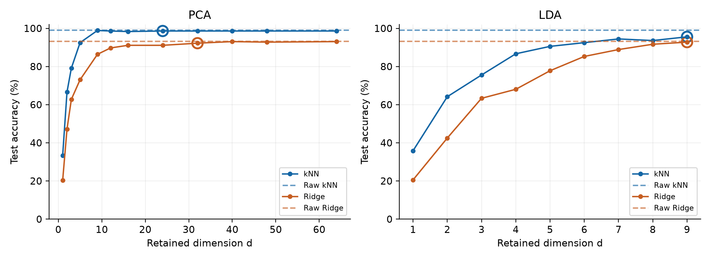
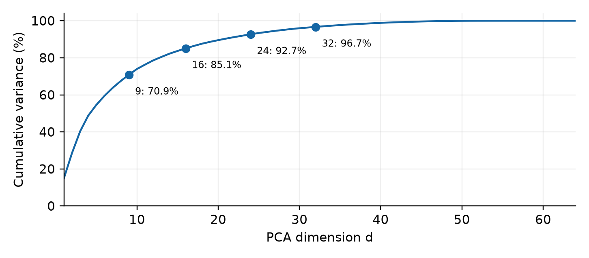

# Dimensionality Reduction
for Handwritten Digit Classification

Assignment 1 | MENG XIANGYU | G2607496E
13 October 2026

## Abstract

This study evaluates the accuracy-compression trade-off of principal component analysis (PCA) and linear discriminant analysis (LDA) on 64-dimensional handwritten digits. Nearest-neighbour and ridge linear classifiers are compared with unreduced baselines using a stratified, held-out test set. Dimensions and classifier parameters are selected exclusively within the non-test training pool. Raw 1-nearest-neighbour classification achieves 99.17% test accuracy. The validation-selected 24-dimensional PCA representation achieves 98.61%, while 9-dimensional LDA achieves 95.56%. Neither reduction improves the corresponding raw baseline in this experiment. PCA nevertheless removes 62.5% of the coordinates with only two additional test errors, demonstrating useful compression rather than a guaranteed accuracy gain.

## 1. Research question and dataset

The central question is how the number of retained coordinates affects classification, and whether preserving overall variation or explicitly separating classes gives a better representation. Redundant coordinates can increase storage and computation, but deleting informative directions can also increase error. The experiment therefore includes the full input as a baseline and evaluates both a local, nonlinear decision rule and a linear decision rule.

The public UCI Optical Recognition of Handwritten Digits dataset [1] provides block counts derived from normalized digit bitmaps. This study uses the 1,797-image subset distributed by scikit-learn's load_digits [2], rather than all 5,620 UCI samples. Each 8 x 8 image gives 64 integer features in the range 0-16 and a label from 0 to 9. There are approximately 180 examples per class and no missing values. The 64 coordinates provide a manageable dimensionality-reduction experiment; they are much smaller than modern high-resolution image representations.

## 2. Preprocessing and evaluation design

All pixels are divided by the known maximum 16, giving values in [0,1]. This fixed conversion uses no estimated test statistics. Pixelwise standardization, augmentation and additional alignment are omitted; the source images already undergo normalization, and all coordinates share the same physical unit. PCA centering and all LDA statistics are estimated only from the data currently used for fitting.

| Partition | Samples | Role |
| --- | --- | --- |
| Fit subset | 1,077 (~60%) | Fit candidate reductions and classifiers |
| Validation subset | 360 (~20%) | Choose dimensions and hyperparameters |
| Held-out test | 360 (~20%) | Final accuracy/error evaluation only |

The first split uses stratification and seed 6222 to reserve 20% for testing. The remaining 1,437 samples form the training/development pool; a stratified 25% split of that pool, with seed 6223, supplies validation. The test set has 35-37 samples per digit. After selection, every final model is refitted on all 1,437 non-test samples. Test features are only transformed, and test labels only score predictions [6]. The saved index arrays verify that the partitions are disjoint.

---

## 3. Dimensionality reduction and classifiers

**PCA.** For fitting observations x_{i}, let mu be their mean and S their sample covariance. PCA retains the d orthonormal eigenvectors with the largest eigenvalues, equivalently obtained by singular value decomposition (SVD) [3].

S = sum_i (x_i-mu)(x_i-mu)^T / (n-1)
z = W_d^T (x-mu)

The implementation uses full SVD and no whitening. A single maximum-size basis is fitted per training stage and its first d columns are retained. This preserves the natural relative scale of projected directions and gives nested representations.

**LDA.** LDA uses labels to contrast between-class scatter S_{B} against within-class scatter S_{W}. With class mean mu_{c} and class size n_{c}, the classical criterion favours projections with large between-class variation relative to within-class variation [4].

S_W = sum_c sum_(i in c) (x_i-mu_c)(x_i-mu_c)^T
S_B = sum_c n_c (mu_c-mu)(mu_c-mu)^T
S_B w = lambda S_W w

The SVD solver avoids directly inverting a potentially singular covariance matrix. Class proportions are inferred from fitting labels, the numerical rank tolerance is 10^{-4}, and no shrinkage is used. With ten classes, the discriminant subspace has at most nine directions. LDA is used only as a feature transformation; classification is subsequently performed by the same two classifier families.

**Classifiers.** k-nearest neighbours (kNN) uses Euclidean distance and uniform voting; neighbour search is brute force. The ridge classifier [5] learns ten linear scores with an unpenalized intercept and selects the largest score. It minimizes squared loss with an L2 penalty on coefficients; each one-versus-rest target column is encoded as +1 for the relevant class and -1 otherwise.

min_(B,b) ||Y - ZB - 1 b^T||_F^2 + alpha ||B||_F^2

| Setting | Predeclared candidates |
| --- | --- |
| Raw dimension | 64 |
| PCA dimensions | 1, 2, 3, 5, 9, 12, 16, 24, 32, 40, 48, 64 |
| LDA dimensions | 1, 2, 3, 4, 5, 6, 7, 8, 9 |
| kNN neighbours k | 1, 3, 5, 7, 9 |
| Ridge penalty alpha | 0.01, 0.1, 1, 10, 100 |

For each of the six representation/classifier pairs, (d, parameter) jointly maximizes validation accuracy. Ties favour the smaller dimension, then the earlier parameter in the listed grid. This gives 220 validation configurations in total. The selected parameter is then fixed across that pair's entire test curve; the dimension selected on validation is highlighted. Test peaks do not change any selection. Accuracy is 100 times the number of correct predictions divided by 360, and error rate is 100% minus accuracy.

---

## 4. Results: accuracy against retained dimension

Figure 1. Final test accuracy. Hollow rings denote validation-selected dimensions; dashed lines are independently tuned raw baselines. Each solid curve uses the parameter selected for that representation/classifier pair, not a new parameter at every test point.

Table 1 lists the configurations chosen before test evaluation. Validation accuracy comes from models fitted on 1,077 samples; test accuracy comes from refitted models using 1,437 samples. These scores therefore differ in both evaluation samples and training-set size. All test comparisons use the same 360 held-out observations.

| Representation | Classifier | d | k / alpha | Val. % | Test % | Errors |
| --- | --- | --- | --- | --- | --- | --- |
| Raw | kNN | 64 | 1 | 98.89 | 99.17 | 3 |
| Raw | Ridge | 64 | 1 | 92.22 | 93.33 | 24 |
| PCA | kNN | 24 | 5 | 98.89 | 98.61 | 5 |
| PCA | Ridge | 32 | 10 | 92.50 | 92.22 | 28 |
| LDA | kNN | 9 | 1 | 97.50 | 95.56 | 16 |
| LDA | Ridge | 9 | 0.01 | 91.67 | 92.78 | 26 |

Table 1. Validation-selected configurations. k applies to kNN and alpha to Ridge.

**PCA trend.** With k=5, accuracy rises from 33.33% at d=1 to 79.17% at d=3 and 92.50% at d=5. The predeclared d=9 point reaches 98.89%, followed by a plateau near 98-99%. The validation-selected d=24 gives 355 correct predictions (98.61%). The slightly higher d=9 test value is a descriptive result, not permission to replace the validation-selected configuration. Ridge needs more coordinates: it rises from 20.28% at d=1 to 86.39% at d=9 and 92.22% at the selected d=32.

**LDA trend.** Accuracy generally increases as additional discriminant directions are retained, although kNN has a small decrease between d=7 and d=8. Both classifiers select d=9 on validation. At that dimension, kNN reaches 95.56% and Ridge reaches 92.78%. A label-informed reduction can lose useful local distinctions despite using labels; this result does not establish that a nine-dimensional limit necessarily causes information loss.

**Classifier dependence.** At the shared d=9, PCA+kNN exceeds LDA+kNN (98.89% versus 95.56%), whereas LDA+Ridge exceeds PCA+Ridge (92.78% versus 86.39%). These comparisons describe independently tuned pipelines, not an isolated causal effect of the transformation. The overall pattern suggests that the usefulness of a representation depends on the downstream decision rule.

---

## 5. Interpretation: compression, geometry and uncertainty

Figure 2. Cumulative PCA variance estimated from the 1,437-sample non-test training pool after final refitting. It is an explanatory statistic, not a test-dependent criterion for choosing d.

**Variance versus discrimination.** The first 9 PCA directions preserve 70.85% of fitting variance, while 24 and 32 preserve 92.68% and 96.68%, respectively. High kNN accuracy at d=9 despite incomplete variance retention shows that total variation and label discrimination are different objectives. Conversely, the weak d=1-3 results show that aggressive reduction discards necessary digit structure. The plateau does not establish that all discarded variation is noise; only that these extra coordinates add little accuracy for this pipeline and split.

**Compression.** The selected PCA+kNN pipeline reduces 64 coordinates to 24 (62.5% fewer). For 1,437 stored reference vectors, coordinate storage decreases from 91,968 to 34,488 numbers. Brute-force distance arithmetic scales approximately with n x d, so its distance stage uses 37.5% of the original coordinate operations. This excludes projection, basis storage and other overheads; no wall-clock speedup is claimed. LDA reduces coordinate count by 85.94%, but sacrifices more kNN accuracy.

**Why supervised LDA is not automatically better.** LDA optimizes a global scatter criterion, while kNN relies on local distances. Its rescaling of directions and nine-dimensional limit can change local neighbourhoods. PCA preserves orthogonal directions of large global variation. The observed ranking is consistent with this geometric difference, but does not identify a single cause or prove a general advantage of unsupervised learning.

**Implementation control.** With identical k=1, raw and full 64-dimensional PCA produce the same 360 predictions; the same is true for Ridge with alpha=1. Full unwhitened PCA preserves Euclidean distances and the isotropic ridge penalty under an orthogonal change of coordinates. The plotted PCA-64 values differ from the raw baselines because PCA selected k=5 and alpha=10 independently. That difference must not be attributed to dimension reduction.

**Sampling uncertainty.** Approximate marginal 95% Wilson intervals are 97.58-99.72% for raw kNN, 96.79-99.41% for selected PCA+kNN, and 92.90-97.25% for selected LDA+kNN. These intervals assume independent test outcomes conditional on the fitted model; they do not measure split variability. In the paired PCA+kNN comparison, zero test cases are correct only after PCA and two are correct only before PCA. Two errors are a small difference on 360 cases; no formal superiority or equivalence claim is made.

---

## 6. Limitations and conclusions

A single stratified split cannot establish robustness across seeds or data sources. The bundled data are a subset of the original UCI test partition, resplit here for this study. This is a new sample-level experiment, not the original UCI benchmark. Writer identities are not exposed by load_digits, so the partitions are not guaranteed to contain disjoint writers. The reported results should therefore not be treated as recognition accuracy on entirely unseen writers. Also, 64 features is a relatively modest scale; findings need not transfer to larger images or small-sample covariance estimation.

Validation selection itself can be optimistic because 220 candidates share one validation set. A stronger future design would select configurations using repeated stratified cross-validation inside the training pool and reserve an independent writer-level test set. It could also compare regularized discriminant projections and additional linear classifiers. Such extensions should be specified before evaluating a fresh test set, rather than tuned using the present curves.

This experiment gives three conclusions. First, very low dimensions lose class information, while moderate PCA dimensions retain high kNN accuracy. Second, classification performance depends jointly on the projection and the classifier: LDA's label information does not ensure better nearest-neighbour classification. Third, none of the validation-selected reduced pipelines outperforms its raw baseline here. When accuracy is the priority, the raw kNN baseline is preferable on the reported split; when fewer coordinates are valuable, 24-dimensional PCA offers substantial compression with a small observed accuracy cost. Dimensionality reduction is therefore an accuracy-compression trade-off whose benefit must be established experimentally.

## 7. Reproducibility

Run python -m pip install -r requirements.txt, then python experiment.py. The experiment was run with Python 3.12.14, NumPy 2.3.5, SciPy 1.18.1, scikit-learn 1.9.1 and Matplotlib 3.11.2. The program uses one numerical-library thread and does not require a runtime dataset download. It exports validation_grid.csv, selections.json, test_curves.csv, results.json, partition indices, predictions and figures. The complete 221-line experiment source is reproduced verbatim in Appendix A; line numbers are added only for readability.

## References

[1] E. Alpaydin and C. Kaynak, "Optical Recognition of Handwritten Digits," UCI Machine Learning Repository, 1998. Dataset DOI: 10.24432/C50P49. [Online source](https://doi.org/10.24432/C50P49). Accessed 13 October 2026.

[2] scikit-learn developers, "load_digits," API documentation. [Online source](https://scikit-learn.org/stable/modules/generated/sklearn.datasets.load_digits.html). Accessed 13 October 2026.

[3] scikit-learn developers, "PCA," API documentation. [Online source](https://scikit-learn.org/stable/modules/generated/sklearn.decomposition.PCA.html). Accessed 13 October 2026.

[4] scikit-learn developers, "Linear and Quadratic Discriminant Analysis," User Guide. [Online source](https://scikit-learn.org/stable/modules/lda_qda.html). Accessed 13 October 2026.

[5] scikit-learn developers, "RidgeClassifier," API documentation. [Online source](https://scikit-learn.org/stable/modules/generated/sklearn.linear_model.RidgeClassifier.html). Accessed 13 October 2026.

[6] scikit-learn developers, "Common pitfalls and recommended practices," User Guide. [Online source](https://scikit-learn.org/stable/common_pitfalls.html). Accessed 13 October 2026.