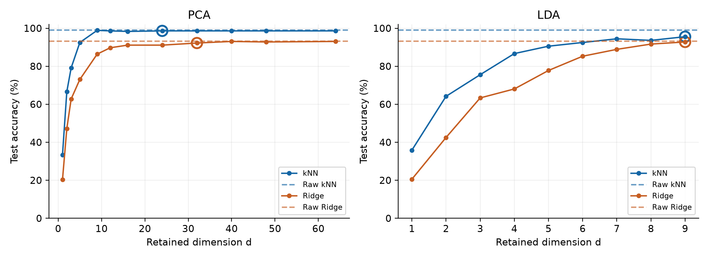
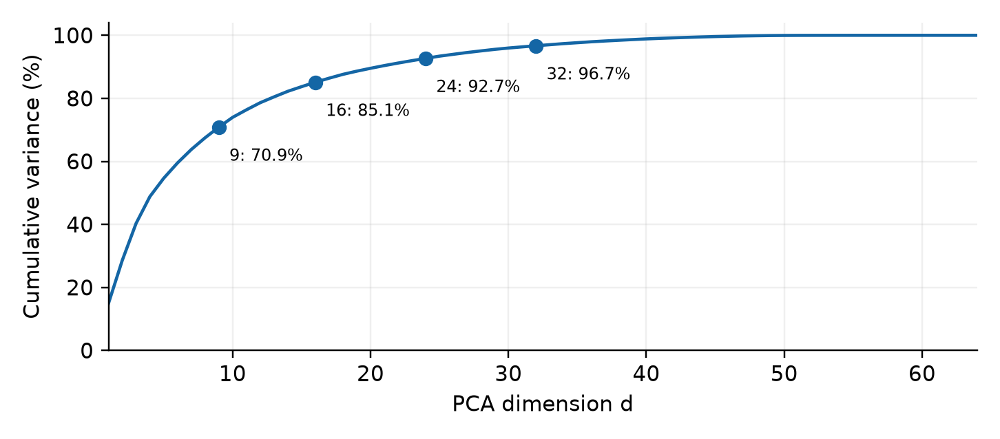

# Dimensionality Reduction for Handwritten Digit Classification

Assignment 1 | MENG XIANGYU | G2607496E
13 October 2026

## Abstract

The experiment examines the trade-off between classification accuracy and feature compression when principal component analysis (PCA) and linear discriminant analysis (LDA) are applied to 64-dimensional handwritten digits. It compares k-nearest-neighbour and ridge classifiers with raw-feature baselines on a stratified held-out test set. Dimensions and classifier settings are chosen within the non-test training pool. The raw 1-nearest-neighbour model reaches 99.17% test accuracy. The validation-selected 24-dimensional PCA model reaches 98.61%, while the 9-dimensional LDA model reaches 95.56%. Neither reduced representation beats its raw counterpart, but PCA removes 62.5% of the coordinates at the cost of only two additional test errors.

## 1. Research question and dataset

Two questions guide the experiment: how many coordinates are needed for accurate classification, and whether preserving overall variation or separating classes gives a more useful representation. Extra coordinates can increase storage and computation, while removing informative directions can increase error. The full input therefore serves as a baseline alongside a local nonlinear classifier and a linear classifier.

The public UCI Optical Recognition of Handwritten Digits dataset [1] provides block counts derived from normalized digit bitmaps. This experiment uses the 1,797-image subset distributed by scikit-learn's load_digits [2], rather than all 5,620 UCI samples. Each 8 x 8 image produces 64 integer features in the range 0-16 and a label from 0 to 9. Each class has approximately 180 examples, and there are no missing values. These 64 coordinates provide a manageable setting for studying dimensionality reduction; they are much smaller than modern high-resolution image representations.

## 2. Preprocessing and evaluation design

Each pixel is divided by the known maximum, 16, so that all values lie in [0,1]. This fixed conversion uses no statistic estimated from the test set. Pixelwise standardization, augmentation, and additional alignment are omitted because the source images are already normalized and all coordinates share the same physical unit. PCA centering and all LDA statistics are estimated only from the data used for fitting.

| Partition | Samples | Role |
| --- | --- | --- |
| Fit subset | 1,077 (~60%) | Fit candidate reductions and classifiers |
| Validation subset | 360 (~20%) | Choose dimensions and hyperparameters |
| Held-out test | 360 (~20%) | Final accuracy/error evaluation only |

A stratified split with seed 6222 reserves 20% of the data for testing. The remaining 1,437 samples form the training/development pool; a second stratified split with seed 6223 assigns 25% of that pool to validation. The test set contains 35-37 samples for each digit. After model selection, every final model is refitted on all 1,437 non-test samples. Test features are transformed only after fitting, and test labels are used only to score predictions [6]. The saved index arrays confirm that the partitions are disjoint.

---

## 3. Dimensionality reduction and classifiers

**PCA.** For fitting observations x_{i}, let mu be their mean and S their sample covariance. PCA retains the d orthonormal eigenvectors with the largest eigenvalues, which can be obtained by singular value decomposition (SVD) [3].

S = sum_i (x_i-mu)(x_i-mu)^T / (n-1)

z = W_d^T (x-mu)

The implementation uses full SVD without whitening. At each training stage, it fits one maximum-size basis and retains its first d columns. The resulting representations are nested and keep the natural relative scale of the projected directions.

**LDA.** LDA uses labels to compare between-class scatter S_{B} with within-class scatter S_{W}. Given a class mean mu_{c} and class size n_{c}, the classical criterion favours projections with large between-class variation relative to within-class variation [4].

S_W = sum_c sum_(i in c) (x_i-mu_c)(x_i-mu_c)^T
S_B = sum_c n_c (mu_c-mu)(mu_c-mu)^T
S_B w = lambda S_W w

The SVD solver avoids directly inverting a potentially singular covariance matrix. Class proportions come from the fitting labels, the numerical rank tolerance is 10^{-4}, and no shrinkage is used. With ten classes, the discriminant subspace has at most nine directions. LDA is used only as a feature transformation; classification is then performed by the same two classifier families.

**Classifiers.** k-nearest neighbours (kNN) uses Euclidean distance and uniform voting, with brute-force neighbour search. The ridge classifier [5] learns ten linear scores, uses an unpenalized intercept, and predicts the class with the largest score. It minimizes squared loss with an L2 penalty on the coefficients; each one-versus-rest target column is encoded as +1 for the relevant class and -1 otherwise.

min_(B,b) ||Y - ZB - 1 b^T||_F^2 + alpha ||B||_F^2

| Setting | Predeclared candidates |
| --- | --- |
| Raw dimension | 64 |
| PCA dimensions | 1, 2, 3, 5, 9, 12, 16, 24, 32, 40, 48, 64 |
| LDA dimensions | 1, 2, 3, 4, 5, 6, 7, 8, 9 |
| kNN neighbours k | 1, 3, 5, 7, 9 |
| Ridge penalty alpha | 0.01, 0.1, 1, 10, 100 |

For each representation/classifier pair, the experiment selects the dimension and classifier parameter that give the highest validation accuracy. Ties favour the smaller dimension and then the earlier parameter in the listed grid, producing 220 validation configurations in total. The selected parameter is fixed for the pair's full test curve, while the validation-selected dimension is highlighted. Accuracy is the number of correct predictions divided by 360, expressed as a percentage; error rate is 100% minus accuracy.

---

## 4. Results: accuracy against retained dimension

Figure 1. Test accuracy on the held-out set. Hollow rings mark the dimensions selected on validation; dashed lines show independently tuned raw baselines. Each solid curve uses the parameter selected for its representation/classifier pair.

Table 1 lists the configurations selected before test evaluation. Validation accuracy comes from models fitted on 1,077 samples, whereas test accuracy comes from models refitted on 1,437 samples. All test comparisons use the same 360 held-out observations.

| Representation | Classifier | d | k / alpha | Val. % | Test % | Errors |
| --- | --- | --- | --- | --- | --- | --- |
| Raw | kNN | 64 | 1 | 98.89 | 99.17 | 3 |
| Raw | Ridge | 64 | 1 | 92.22 | 93.33 | 24 |
| PCA | kNN | 24 | 5 | 98.89 | 98.61 | 5 |
| PCA | Ridge | 32 | 10 | 92.50 | 92.22 | 28 |
| LDA | kNN | 9 | 1 | 97.50 | 95.56 | 16 |
| LDA | Ridge | 9 | 0.01 | 91.67 | 92.78 | 26 |

Table 1. Validation-selected configurations. k applies to kNN and alpha to Ridge.

**PCA trend.** With k=5, accuracy rises from 33.33% at d=1 to 79.17% at d=3 and 92.50% at d=5. The d=9 point reaches 98.89% on the test curve, followed by a plateau around 98-99%. Validation selects d=24, which gives 355 correct predictions and 98.61% accuracy. Selecting d=9 after viewing the test curve would use the test set for tuning. Ridge needs more coordinates: its accuracy rises from 20.28% at d=1 to 86.39% at d=9 and 92.22% at the selected d=32.

**LDA trend.** Accuracy generally increases as more discriminant directions are retained, although kNN dips slightly from d=7 to d=8. Both classifiers select d=9 on validation. At that dimension, kNN reaches 95.56% and Ridge reaches 92.78%. A label-informed reduction can still lose local distinctions because the LDA objective is global.

**Classifier dependence.** At the common d=9, PCA+kNN reaches 98.89%, compared with 95.56% for LDA+kNN. For Ridge, LDA reaches 92.78%, compared with 86.39% for PCA. These are independently tuned pipelines, so the pattern describes the interaction between representation and classifier rather than an isolated causal effect of the projection.

---

## 5. Interpretation: compression, geometry and uncertainty

Figure 2. Cumulative PCA variance estimated from the 1,437-sample non-test training pool after final refitting. It is reported to interpret the results, not to choose d from the test curve.

**Variance versus discrimination.** The first 9 PCA directions preserve 70.85% of the fitting variance; 24 and 32 directions preserve 92.68% and 96.68%, respectively. The high kNN accuracy at d=9 shows that total variation and label discrimination are different objectives. The weak results at d=1-3 also show that aggressive reduction removes necessary digit structure. The later plateau only indicates that, for this pipeline and split, additional coordinates add little accuracy.

**Compression.** The selected PCA+kNN pipeline reduces 64 coordinates to 24, a 62.5% reduction. For 1,437 stored reference vectors, coordinate storage falls from 91,968 to 34,488 numbers. Because brute-force distance arithmetic scales approximately with n x d, the distance stage uses 37.5% of the original coordinate operations. This estimate excludes projection, basis storage, and other overheads; the experiment does not measure wall-clock speed. LDA reduces the coordinate count by 85.94%, but loses more kNN accuracy.

**Why supervised LDA is not automatically better.** LDA optimizes a global scatter criterion, whereas kNN relies on local distances. Rescaling the directions and limiting the projection to nine dimensions can change local neighbourhoods. PCA preserves orthogonal directions with large global variation. The observed ranking is consistent with this geometric difference, but it does not identify a single cause or establish a general advantage for either method.

**Implementation control.** With the same k=1, raw features and full 64-dimensional PCA produce identical predictions for all 360 test cases. Ridge gives the same result with alpha=1. Full, unwhitened PCA preserves Euclidean distances and the isotropic ridge penalty under an orthogonal coordinate change. The plotted PCA-64 values differ from the raw baselines because PCA independently selects k=5 and alpha=10.

**Sampling uncertainty.** Approximate marginal 95% Wilson intervals are 97.58-99.72% for raw kNN, 96.79-99.41% for selected PCA+kNN, and 92.90-97.25% for selected LDA+kNN. These intervals describe uncertainty conditional on the fitted model; they do not measure variation across data splits. In the paired PCA+kNN comparison, no test case is correct only after PCA, while two are correct only before PCA. The difference is two errors out of 360, so the experiment does not claim formal superiority or equivalence.

---

## 6. Limitations and conclusions

The experiment uses one stratified split, so it cannot show how the results vary across random seeds or data sources. The supplied data are a subset of the original UCI test partition, re-split for this study; this is a new sample-level experiment rather than the original UCI benchmark. load_digits does not expose writer identities, so the partitions are not guaranteed to contain different writers. The results should therefore not be interpreted as recognition accuracy for entirely unseen writers. Finally, 64 features is a modest scale, and the findings may not transfer to larger images or small-sample covariance estimates.

The validation search can also be optimistic because 220 candidates share one validation set. A stronger follow-up would use repeated stratified cross-validation within the training pool and an independent writer-level test set. It could also compare regularized discriminant projections and additional linear classifiers. These choices should be fixed before evaluating a new test set.

Three conclusions follow. Very low dimensions lose class information, while moderate PCA dimensions retain high kNN accuracy. Performance depends on both the projection and the classifier; using labels in LDA does not guarantee better nearest-neighbour classification. Finally, none of the validation-selected reduced pipelines beats its raw baseline in this experiment. The raw kNN model is the best choice when accuracy is the priority, while 24-dimensional PCA is a useful option when reducing the number of coordinates matters.

## 7. Reproducibility

To reproduce the experiment, run python -m pip install -r requirements.txt and then python experiment.py. The run used Python 3.12.14, NumPy 2.3.5, SciPy 1.18.1, scikit-learn 1.9.1, and Matplotlib 3.11.2. The program uses one numerical-library thread and does not download a dataset at runtime. It exports validation_grid.csv, selections.json, test_curves.csv, results.json, partition indices, predictions, and figures. The complete 221-line experiment source appears verbatim in Appendix A of the submitted PDF; line numbers are included only for readability.

## References

[1] E. Alpaydin and C. Kaynak, "Optical Recognition of Handwritten Digits," UCI Machine Learning Repository, 1998. Dataset DOI: 10.24432/C50P49. [Online source](https://doi.org/10.24432/C50P49). Accessed 13 October 2026.

[2] scikit-learn developers, "load_digits," API documentation. [Online source](https://scikit-learn.org/stable/modules/generated/sklearn.datasets.load_digits.html). Accessed 13 October 2026.

[3] scikit-learn developers, "PCA," API documentation. [Online source](https://scikit-learn.org/stable/modules/generated/sklearn.decomposition.PCA.html). Accessed 13 October 2026.

[4] scikit-learn developers, "Linear and Quadratic Discriminant Analysis," User Guide. [Online source](https://scikit-learn.org/stable/modules/lda_qda.html). Accessed 13 October 2026.

[5] scikit-learn developers, "RidgeClassifier," API documentation. [Online source](https://scikit-learn.org/stable/modules/generated/sklearn.linear_model.RidgeClassifier.html). Accessed 13 October 2026.

[6] scikit-learn developers, "Common pitfalls and recommended practices," User Guide. [Online source](https://scikit-learn.org/stable/common_pitfalls.html). Accessed 13 October 2026.
