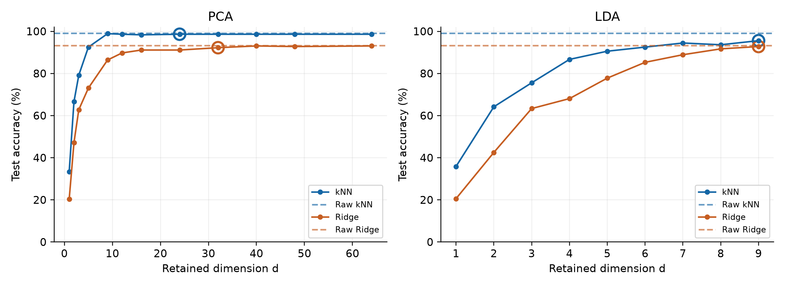
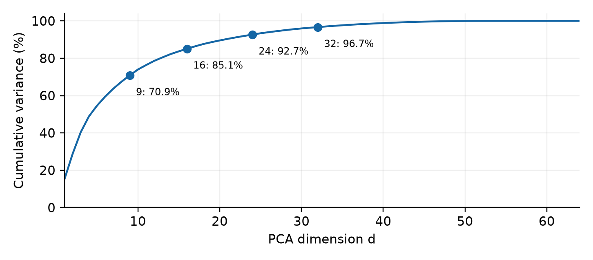

# 手写数字分类中的降维：中文说明报告

Assignment 1 ｜ MENG XIANGYU ｜ G2607496E ｜ 2026 年 10 月 13 日

本说明材料与英文报告使用同一次实验，帮助理解研究思路、程序流程和结果含义。文中的准确率均来自实际运行记录；完整实验代码见 experiment.py，以及英文报告的附录 A。

## 一、这份作业研究什么

作业的核心问题是：把数据从较高维度压缩到较低维度后，分类结果会怎样变化？“维度”就是描述一个样本所用的数值数量。例如，一张 8 × 8 的图片可以按固定顺序展开成 64 个数，因此原始输入有 64 维。降到 24 维，意味着用 24 个新特征表示同一张图片。

降维后的新特征通常是多个原始像素的加权组合，并不是简单保留图片中的 24 个像素。它们可以减少冗余，也可能丢掉区分类别所需的信息。因此，不能预先假定维度越低越好，也不能保证降维一定提升准确率。实验需要比较原始特征、不同维度的降维特征，以及不同分类器。

本实验比较三种表示方式：原始 64 维、PCA 主成分分析、LDA 线性判别分析。每种表示分别搭配 kNN 近邻分类器和 Ridge 岭线性分类器，共六组方法。这样可以观察表示方法和分类器之间的配合关系。

## 二、数据来源和预处理

使用 scikit-learn 的 load_digits()，其中包含公开 UCI 手写数字数据的 1,797 个样本子集 [1][2]。每个样本为 8 × 8 的数字图像，类别是 0 至 9，像素块计数范围为 0 至 16，没有缺失值。这不是完整的 5,620 个 UCI 样本，也不是 MNIST。

所有输入除以已知上限 16，统一转换到 [0,1]。这里的 16 是数据定义中的常数，不需要从测试集估计。原始数据已经过图像规范化处理，因此没有再添加数据增强、额外对齐或逐像素标准化。PCA 所需的均值，以及 LDA 所需的类别统计量，均只用当前拟合数据计算。

## 三、为什么分成训练、验证、测试三部分

| 数据部分 | 样本数 | 用途 |
| --- | --- | --- |
| 拟合子集 | 1,077，约 60% | 学习降维方向及分类器 |
| 验证子集 | 360，约 20% | 选择维度和分类器参数 |
| 测试集 | 360，约 20% | 对最终配置计算准确率和错误率 |

先用随机种子 6222 分层划出 20% 测试集，再用种子 6223 从剩余数据中划出验证集。“分层”表示各部分尽量维持数字类别的原有比例。拟合子集和验证子集合称训练／开发数据，共 1,437 个样本；参数选定后，最终模型在这全部 1,437 个样本上重新拟合。

这个流程符合题目对训练和测试的限制：测试集不参与选择维度、分类器参数、均值或投影矩阵 [6]。否则，模型就可能间接适应测试题目，报告的准确率会偏乐观。保存的 split_indices.npz 可以检查三部分是否存在样本重叠。

---

## 四、PCA 和 LDA 分别在做什么

### 1. PCA：保留变化较大的方向

PCA 不使用类别标签。它在拟合数据中寻找变化最大的方向，再找与前一方向正交、变化次大的方向，依次排列 [3]。可以把它理解成：为图片重新选择一套坐标轴，希望用较少的坐标保留较多的整体变化。

对一张图片的特征向量 x，先减去拟合数据均值 mu，再投影到前 d 个主成分方向。用符号表示如下：

```text
z = W_d^T (x - mu)
```

其中 W_d 的列是保留的 d 个方向，z 就是降维后的特征。本实验通过完整奇异值分解（full SVD）求解，不进行白化（whitening），因此没有把所有主成分强制调整到相同方差。每次拟合先得到完整方向，再取前 d 个，保证不同维度使用同一套按顺序排列的方向。

PCA 保留“变化大”的方向，但变化大不一定等于“最能区分数字”。例如，某种笔画变化可能主要反映书写风格，而不是类别。这个区别解释了为什么方差保留率不能直接当作分类准确率。

### 2. LDA：利用标签增强类别分离

LDA 使用类别标签。它希望同一数字的样本投影后更集中，而不同数字的中心更分开 [4]。传统表述是比较类间散度 S_B 与类内散度 S_W，并寻找具有较大类间／类内散度比的方向。

```text
S_B w = lambda S_W w
```

本实验采用 SVD 求解，不直接求逆可能奇异的协方差矩阵；容差为 0.0001，不使用协方差收缩。十个类别的均值相对整体均值最多形成九个独立方向，因此 LDA 最多保留 10 - 1 = 9 维。这里把 LDA 当作特征提取方法，随后再用 kNN 或 Ridge 分类，而不是直接使用 LDA 自身的分类预测。

### 3. 两种分类器

**kNN：** 对新图片找到欧氏距离最近的 k 个拟合样本，由这些邻居进行等权投票。k=1 表示直接使用最近样本的类别。本实验采用暴力搜索。kNN 可以利用复杂的局部形状，但也容易受到距离空间变化影响。

**Ridge：** 学习十个线性类别得分，预测得分最大的类别。训练目标是平方损失加上系数的 L2 惩罚，alpha 控制惩罚强度，截距不受惩罚 [5]。Ridge 的边界是线性的，因此即使使用同一表示，也可能与 kNN 有明显不同的效果。

### 4. 参数如何选择

PCA 候选维度为 1、2、3、5、9、12、16、24、32、40、48、64；LDA 为 1 至 9。kNN 的 k 候选为 1、3、5、7、9；Ridge 的 alpha 候选为 0.01、0.1、1、10、100。原始输入始终为 64 维。

在每组“表示方式＋分类器”内，联合选择验证准确率最高的“维度＋参数”。如果相同，先选更小的维度，再按上述参数顺序选择。共评价 220 个验证配置。选出的分类器参数在整条测试曲线上保持固定；不能在看过测试结果之后再更改选择。

---

## 五、实际结果和曲线应该怎么读



图 1：横轴是保留维度，纵轴是测试准确率。左图为 PCA，右图为 LDA；蓝色为 kNN，橙色为 Ridge。虚线表示各自调参后的原始 64 维基线，空心圆表示验证集选出的维度。图中英文术语与本说明使用的缩写一致。

| 表示 | 分类器 | 维度 | k／alpha | 验证准确率 | 测试准确率 | 错误数 |
| --- | --- | --- | --- | --- | --- | --- |
| 原始特征 | kNN | 64 | 1 | 98.89% | 99.17% | 3 |
| 原始特征 | Ridge | 64 | 1 | 92.22% | 93.33% | 24 |
| PCA | kNN | 24 | 5 | 98.89% | 98.61% | 5 |
| PCA | Ridge | 32 | 10 | 92.50% | 92.22% | 28 |
| LDA | kNN | 9 | 1 | 97.50% | 95.56% | 16 |
| LDA | Ridge | 9 | 0.01 | 91.67% | 92.78% | 26 |

表 1：六组方法各自通过验证集选出的配置。k 对应 kNN，alpha 对应 Ridge。测试集共 360 个样本，准确率＝正确数／360 × 100%；错误率＝100%－准确率。例如，PCA＋kNN 判对 355 个，错误 5 个，准确率为 98.61%。

**PCA 曲线：** 在固定 k=5 时，1 维只有 33.33% 准确率，3 维为 79.17%，5 维达到 92.50%。继续增加维度后，kNN 曲线进入约 98% 至 99% 的平台。Ridge 对维度更敏感，9 维只有 86.39%，验证选择的 32 维为 92.22%。

**为什么不是选择 9 维？** PCA＋kNN 的 9 维测试点达到 98.89%，略高于 24 维的 98.61%；但最终配置必须由验证集决定。验证阶段按预定规则选中了 24 维和 k=5。此时再根据测试曲线改为 9 维，就把测试集当成了调参工具。因此，9 维点只能用来描述曲线现象。

**LDA 与分类器的关系：** 两种分类器都在验证阶段选择了 9 维。在共同的 9 维测试点，PCA＋kNN 为 98.89%，高于 LDA＋kNN 的 95.56%；而 LDA＋Ridge 为 92.78%，高于 PCA＋Ridge 的 86.39%。可见不能只看“监督／无监督”标签判断效果。这些是分别调参的完整流程比较，不是单独改变投影方法的因果实验。

验证分数来自使用 1,077 个样本拟合的模型；测试分数来自使用 1,437 个样本重拟合的模型。两列不仅评价样本不同，拟合样本数也不同，因此不能把分数差直接解释为模型变好或变差。

---

## 六、降维的收益、原因和局限



图 2：最终在 1,437 个非测试样本上拟合得到的 PCA 累计方差保留率。它用于解释结果，不用于根据测试表现重新选择维度。9、24、32 维分别保留 70.85%、92.68%、96.68% 的拟合数据方差。

### 1. 本实验主要获得了压缩收益

验证选中的 PCA＋kNN 将输入从 64 维降到 24 维，坐标数量减少 (64 - 24)／64 = 62.5%，测试准确率下降约 0.56 个百分点，对应多错 2 张图片。LDA 的 9 维坐标数量减少 85.94%，但其 kNN 测试准确率比原始基线低约 3.61 个百分点。

对于需要保存 1,437 个参考样本的 kNN，原始特征包含 91,968 个坐标，24 维特征包含 34,488 个坐标。暴力距离计算的坐标运算量大致与“参考样本数 × 维度”成正比，降维后的这部分运算量约为原来的 37.5%。这不等于总运行时间减少 62.5%，也不等于整个模型存储减少 62.5%；投影计算、投影矩阵和其他开销尚需考虑，实验没有测量实际加速。

### 2. 为什么 LDA 没有胜过 PCA＋kNN

LDA 优化的是全局类别散度，而 kNN 依赖局部邻居关系。LDA 对方向的重新缩放和投影可能改变局部距离；标签信息本身不能保证所有局部关系都得到保留。PCA 虽然不使用标签，却可能留下有利于局部分类的几何结构。这是与结果相符的解释，尚不能证明唯一原因，也不能证明 PCA 一般优于 LDA。

### 3. 完整 PCA 与原始特征的检查

如果保留全部 64 个 PCA 方向并且不白化，欧氏距离在正交坐标变换下保持不变；相同 alpha 下的各向同性岭惩罚也应保持对应关系。程序验证：相同 k=1 时两种表示的 360 个测试预测完全一致；相同 alpha=1 时 Ridge 预测也全部一致。曲线上 PCA 64 维与原始基线略有不同，是因为分别选中了 k=5 与 k=1、alpha=10 与 alpha=1，不能把这类差异归因于降维。

### 4. 结论的适用范围

原始 kNN、所选 PCA＋kNN、所选 LDA＋kNN 的近似 95% Wilson 区间分别为 97.58%-99.72%、96.79%-99.41%、92.90%-97.25%。这些区间以固定模型、独立测试结果为近似条件，不能衡量更换划分后的波动；同一书写者的多个样本之间的相关性也可能影响其解释。相同测试样本中，PCA＋kNN 没有新增判对案例，只有 2 个原始 kNN 判对而 PCA 判错的案例。因此不宣称两者差异显著，也不证明统计等价。

本实验仅使用一次样本级分层划分。load_digits 不提供书写者身份，不能保证训练和测试来自不同书写者，也不能将结果解释为全新书写者的识别准确率。64 维数据规模相对有限；以后可以在训练数据内做重复交叉验证，并用新的独立书写者测试集评价泛化。

---

## 七、怎样理解最终结论

本实验支持三个结论。第一，过度降维会丢掉有用信息，但适中的 PCA 维度可以保留较高的近邻分类准确率。第二，降维效果取决于后续分类器；LDA 使用标签，仍不能保证对所有分类器都更好。第三，六组验证选择配置中，没有降维配置超过其对应原始基线，因此报告的主要发现是准确率与坐标数量的权衡。

如果只关注本次测试的准确率，原始 64 维、k=1 的近邻基线表现更好。如果希望缩减特征坐标，24 维 PCA 在本次实验中以多 2 个错误的代价减少了 62.5% 的坐标。这个结果说明降维可以有价值，但不能改写成“降维使准确率从 99.17% 提高到 98.61%”。这里是降低，而不是提高；0.56 是百分点差，不是坐标压缩比例。

## 八、程序流程与复现

首先在项目目录执行：

```text
python -m pip install -r requirements.txt
python experiment.py
```

此次运行使用 Python 3.12.14、NumPy 2.3.5、SciPy 1.18.1、scikit-learn 1.9.1 和 Matplotlib 3.11.2。数字数据包含在 scikit-learn 中，运行时无需单独下载。主程序使用一个数值库线程，并保存数据副本和划分索引。

建议按照这五步阅读 experiment.py：① main() 读取、缩放和划分数据；② features() 只在拟合数据上学习降维方向；③ 验证循环遍历 220 个配置并执行平局规则；④ 先保存 selections.json，再在完整开发集重拟合并评价测试曲线；⑤ 保存结果、检查完整 PCA 等价性并绘图。classifier() 负责按名称创建 kNN 或 Ridge。

| 文件 | 阅读目的 |
| --- | --- |
| validation_grid.csv | 核对全部验证参数搜索 |
| selections.json | 核对在测试评价前选定的六组配置 |
| test_curves.csv | 读取各维度准确率、错误率和正确数量 |
| results.json | 核对汇总结果、区间、方差比例和软件版本 |
| split_indices.npz | 检查数据划分，确认样本互不重叠 |
| test_predictions.npz | 查看所选配置的逐样本预测 |

原始 64 维与完整 PCA 的相同参数检查属于实现验证，不用于改变参数选择。单次验证集上搜索较多候选本身也有选择偏差；后续重复交叉验证应仅在训练／开发数据中进行。

## 九、参考资料

[1] Alpaydin 与 Kaynak，UCI Optical Recognition of Handwritten Digits，1998。[数据来源](https://doi.org/10.24432/C50P49)。

[2] scikit-learn，[load_digits 数据说明](https://scikit-learn.org/stable/modules/generated/sklearn.datasets.load_digits.html)。

[3] scikit-learn，[PCA 文档](https://scikit-learn.org/stable/modules/generated/sklearn.decomposition.PCA.html)。

[4] scikit-learn，[线性与二次判别分析用户指南](https://scikit-learn.org/stable/modules/lda_qda.html)。

[5] scikit-learn，[RidgeClassifier 文档](https://scikit-learn.org/stable/modules/generated/sklearn.linear_model.RidgeClassifier.html)。

[6] scikit-learn，[数据泄漏与常见实践错误](https://scikit-learn.org/stable/common_pitfalls.html)。以上资料已于 2026 年 10 月 13 日核验。
